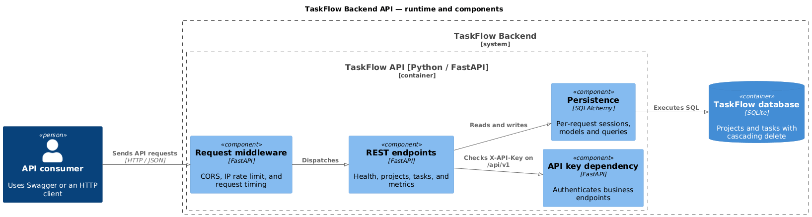

# TaskFlow Backend API

API REST para organizar projetos e tarefas, consultar métricas e filtrar tarefas por
status, prioridade, projeto, responsável ou título. O acesso a `/api/v1` requer
`X-API-Key`; `/health` e `/docs` são públicos.

**Stack:** Python 3.12 · FastAPI · Pydantic · SQLAlchemy · SQLite · pytest · Ruff · mypy

## Arquitetura



- `task_manager_api.py`: composição da aplicação, middleware, autenticação e rotas HTTP.
- `taskflow_models.py`: modelos SQLAlchemy e contratos de entrada/saída Pydantic.
- `taskflow_config.py` e `taskflow_rate_limit.py`: configuração validada e limite por IP.
- SQLite: uma sessão por requisição, com chaves estrangeiras habilitadas. Excluir um
  projeto também exclui suas tarefas; tarefas independentes têm `project_id: null`.

A fonte do diagrama é [docs/architecture.puml](docs/architecture.puml). Para renderizar
com Java e PlantUML 1.2026.2: `java -jar plantuml.jar -failfast2 docs/architecture.puml`.
O render utiliza o layout Smetana e baixa as inclusões C4 versionadas.

## Desenvolvimento local

Pré-requisitos: Python 3.12 e pip (ou Docker com Compose).

```sh
python3.12 -m venv .venv
source .venv/bin/activate
python -m pip install -r requirements-dev.txt
cp .env.example .env
python -c 'import secrets; print(secrets.token_urlsafe(32))'
```

Preencha `API_SECRET_KEY` em `.env` com a chave gerada. Nunca publique essa chave.
Inicie a API usando a fábrica da aplicação:

```sh
uvicorn task_manager_api:create_app --factory --env-file .env --reload
curl --fail http://127.0.0.1:8000/health
```

Abra [OpenAPI/Swagger](http://127.0.0.1:8000/docs) e use **Authorize** para fornecer
o cabeçalho `X-API-Key`. A API responde com `401` para chave ausente ou inválida,
`422` para dados inválidos, `404` para recurso inexistente, `409` para nome de
projeto duplicado e `429` ao atingir o limite. `PATCH` mantém campos omitidos e
só aceita `null` nos campos opcionais.

| Variável | Padrão | Função |
|---|---|---|
| `API_SECRET_KEY` | nenhum; obrigatória | Mínimo de 32 caracteres ASCII imprimíveis, sem espaços. |
| `DATABASE_URL` | `sqlite:///./taskflow_v2.db` | URL SQLAlchemy. O projeto fornece e testa o driver SQLite. No Compose, o banco usa o volume `taskflow-data`. |
| `CORS_ALLOWED_ORIGINS` | vazio | Origens de navegador separadas por vírgula, incluindo esquema e porta. Vazio desabilita acesso entre origens. |
| `RATE_LIMIT_MAX_REQUESTS` | `120` | Máximo de requisições por IP em cada janela. |
| `RATE_LIMIT_WINDOW_SECONDS` | `60` | Duração da janela em segundos. |

O limite é local a cada processo e não se aplica à sondagem `/health`. Para
implantar com múltiplos processos ou réplicas, use um limitador compartilhado
no proxy e configure o proxy de confiança explicitamente. Use HTTPS e mantenha a
chave em um serviço confiável; não a distribua com um frontend público.

## Testes, lint e build

```sh
pytest
ruff check .
ruff format --check .
mypy
docker build -t taskflow:local .
```

O pytest usa bancos isolados; não requer `.env` nem altera o banco de desenvolvimento.
O GitHub Actions executa essas verificações em pushes e pull requests.

## Docker e dados existentes

Depois de criar e configurar `.env`, execute `docker compose up --build`.
O serviço escuta em `127.0.0.1:8000` e mantém o SQLite em um volume do Docker.
`docker compose down` preserva os dados; `down -v` apaga o volume.

Não há migração de esquema nesta versão. Antes de atualizar, faça backup do banco
e execute `PRAGMA foreign_key_check;` no SQLite para verificar se há tarefas órfãs
criadas por versões anteriores; resolva as inconsistências antes de implantar.
Se quiser manter um banco existente ao migrar para Docker, restaure o backup no
volume com permissão de escrita para o UID 10001. Cadastre uma nova chave no
ambiente de execução e atualize os clientes; a chave antiga embutida no código
não é mais aceita por padrão.
